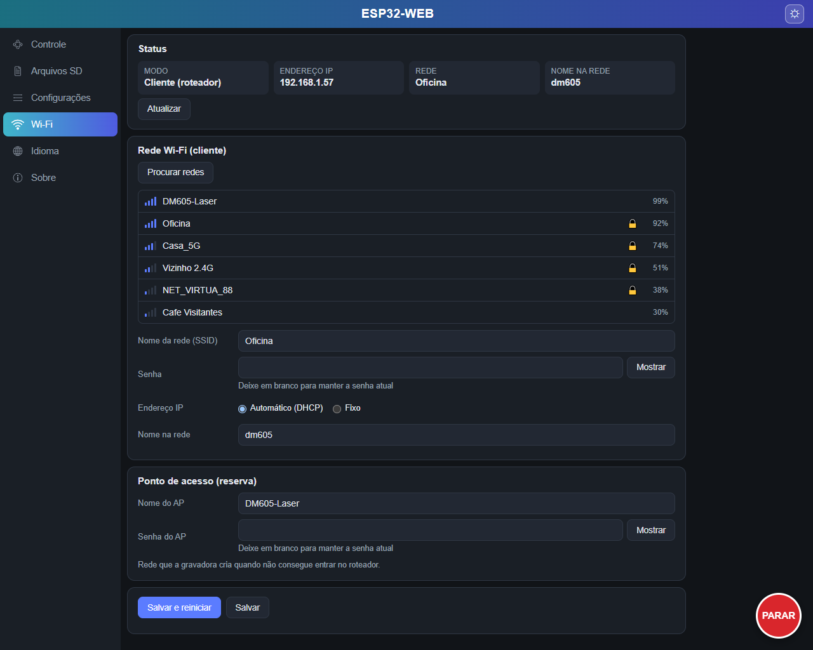
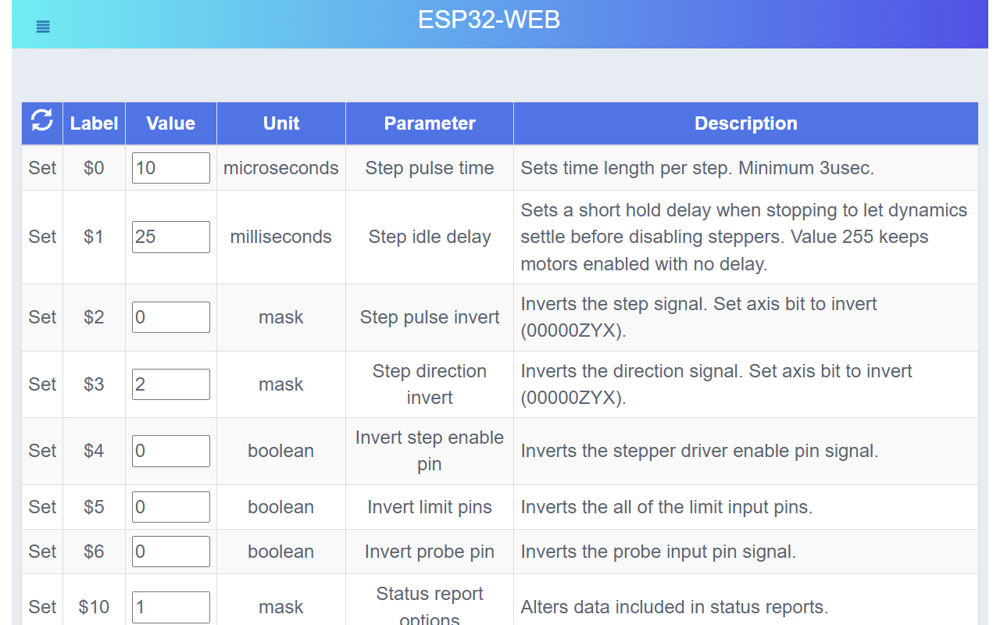
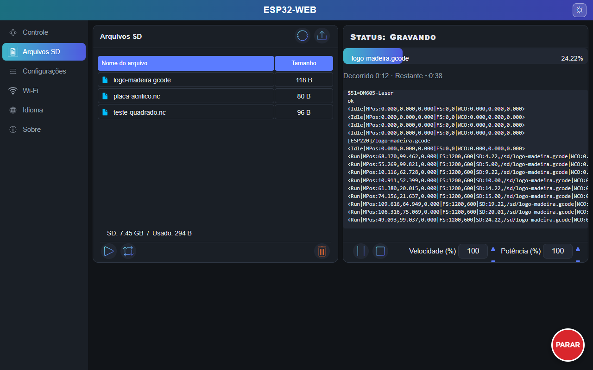
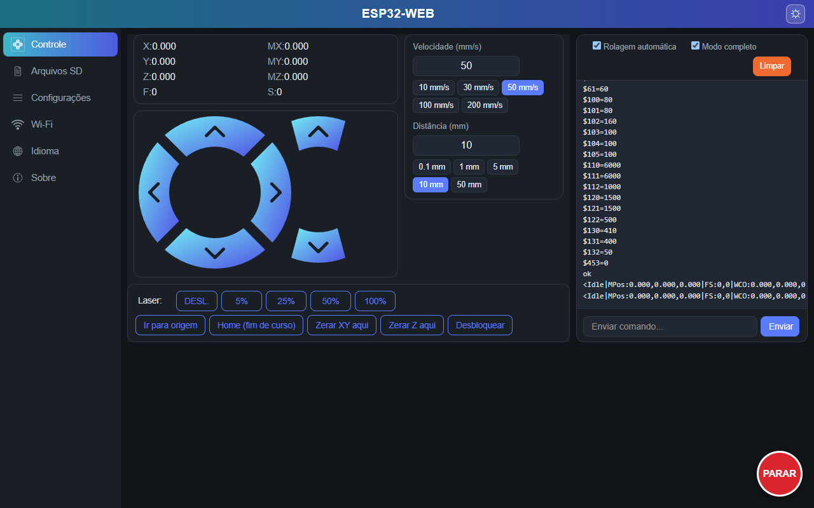
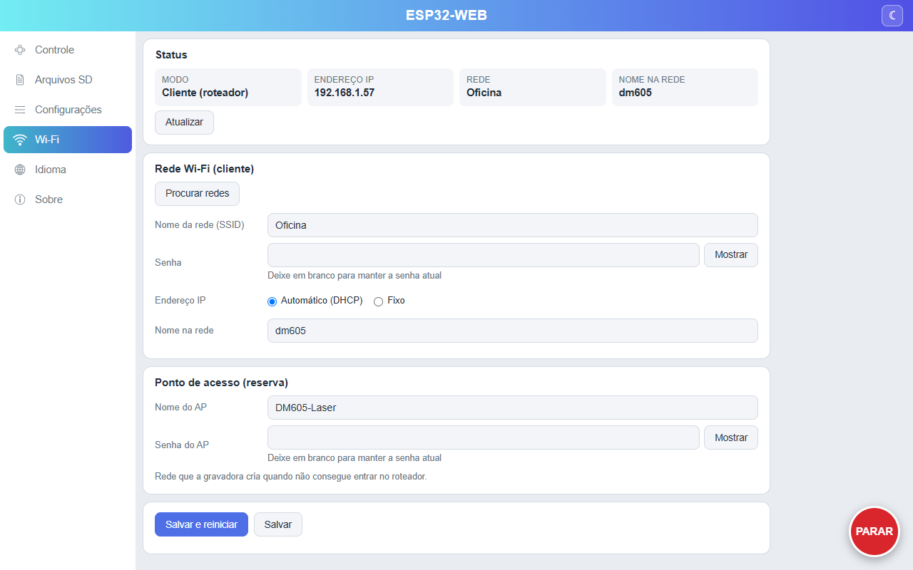
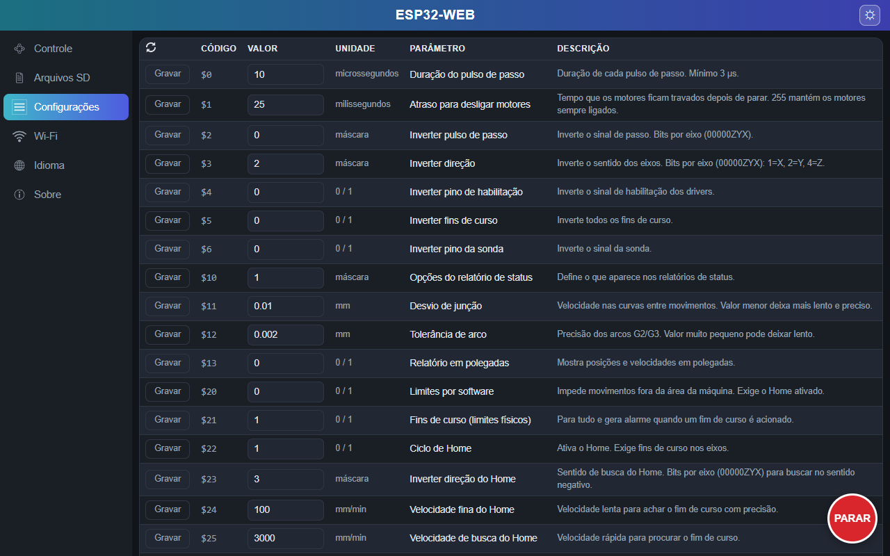
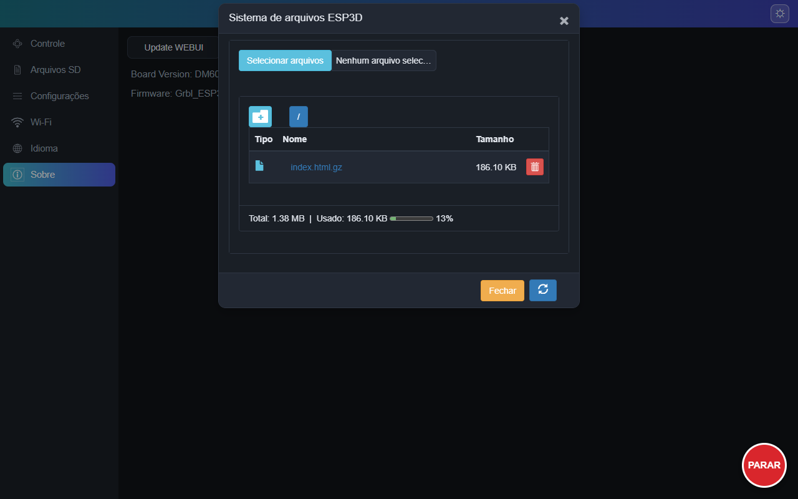

# Interface web — gravadora laser xuupuuf DM605

Versão melhorada da interface web que roda na placa da DM605 (ESP3D / GRBL_ESP32).

**A principal mudança: dá para configurar o Wi-Fi por uma tela própria.** Antes era preciso achar e editar os parâmetros na mão. Agora basta escolher a rede, digitar a senha e gravar.

A placa continua com o mesmo firmware: só a página web (`index.html.gz`) é trocada.



```
interface-original/   interface de fábrica (backup, base para gerar a nova)
nova-interface/
  index.html.gz       ← o arquivo que vai para a placa
  index.html          mesma coisa, sem compactar (para conferir/editar)
  fonte/              código das melhorias (não vai para a placa)
Makefile              atalhos para gerar, testar e enviar
```

## Novidades

### Wi-Fi sem procurar parâmetros (principal novidade)
Na interface de fábrica, para colocar o laser na sua rede era preciso achar os parâmetros certos (SSID, senha, modo de IP…) no meio da lista de configurações e editar um por um:



Agora:

- Nova aba **Wi-Fi** (no topo e no menu lateral) com o status atual: modo, IP, rede conectada e nome na rede.
- **Procurar redes**: lista as redes próximas com intensidade do sinal e cadeado nas redes com senha. É só clicar para preencher.
- Configuração da rede (SSID e senha), IP fixo ou DHCP, nome na rede (hostname) e da rede própria do laser (ponto de acesso).
- Antes de gravar, confere os dados (tamanho do nome e da senha, formato do IP). Depois de gravar, lê o valor de volta da placa e mostra ✓ ou ✗ em cada item.
- Botões **Salvar** e **Salvar e reiniciar**. O segundo avisa que o laser pode mudar de IP e, se não conseguir conectar, normalmente volta a criar a própria rede.

### Português
- Interface toda em **português do Brasil**, que passa a ser o idioma padrão. Inglês e chinês continuam disponíveis em Idioma.
- As mensagens de erro do GRBL (`error:NN`) são explicadas em português.

### Segurança na operação
- Botão vermelho **PARAR** sempre visível no canto da tela. Ele reseta a placa na hora e para laser e movimento. Depois é preciso clicar em Desbloquear e fazer o Home de novo.
- O botão **DESL.** do laser agora desliga de verdade (envia `M5`).

### Trabalhos
- **Cronômetro**: tempo decorrido e estimativa do tempo restante durante a gravação.
- Ao terminar, toca um bipe e mostra o tempo total.
- **Enquadramento** corrigido: o contorno usa só os movimentos de corte/gravação do arquivo e não inclui mais a origem (0,0) à força.



### Controle
- Atalhos de **velocidade** (10, 30, 50, 100, 200 mm/s) e **distância** (0,1, 1, 5, 10, 50 mm) para movimentar o cabeçote.
- Layout mais compacto, sem os sliders verticais gigantes.
- **Tema escuro/claro** (botão ☀/☾). O escolhido fica salvo no navegador.





### Configurações
- Nomes e descrições corretos para os parâmetros próprios deste firmware. Exemplos: `$101` e `$102` são os passos/mm do eixo Y no modo normal e no modo rotativo, não do Y e do Z; `$44` é o air assist; `$43` é o sensor de chama.
- Cada parâmetro tem seu botão **Gravar** (ou Enter). A interface confere o valor gravado na placa e marca a linha como alterada, salvando, ✓ salvo ou ✗ erro.



### Correções internas
- Nomes de arquivo e de pasta com caracteres especiais não quebram mais a página.
- Removidos trechos que executavam texto vindo da placa como código (`eval`).

## Como atualizar a placa

### Passo 0 — Conectar na rede do laser (modo AP)
O upload é feito com o computador **conectado direto na rede Wi-Fi que o próprio laser cria** (modo ponto de acesso, AP).

1. Ligue o laser e, no computador ou celular, procure a rede Wi-Fi criada por ele e conecte-se.
2. Abra no navegador o IP do laser nessa rede. No ESP3D o padrão costuma ser `http://192.168.0.1/`. Se não abrir, veja o IP do gateway na conexão Wi-Fi do computador.

Nos passos abaixo, `IP-DA-PLACA` é esse endereço.

> Antes da primeira atualização, baixe o `index.html.gz` atual da placa (`http://IP-DA-PLACA/index.html.gz`) e guarde. Se algo der errado, é só enviar esse arquivo de volta. O de fábrica também está em `interface-original/`.

Depois de atualizar, use a nova aba **Wi-Fi** para colocar o laser na rede da sua casa ou oficina.

### Opção 1 — Pela própria interface (sem instalar nada)
1. Com o computador na rede do laser (Passo 0), abra `http://IP-DA-PLACA/`.
2. Vá em **About/Sobre → Update WEBUI**. Abre o gerenciador de arquivos da placa (ESP3D Filesystem).
3. Em **Selecionar arquivos**, escolha `nova-interface/index.html.gz` e envie, substituindo o que já existe na raiz (`/`).
4. Recarregue a página com **Ctrl+F5**.



*Os prints foram feitos com a placa simulada (`make simular`). Redes, IP e valores são de exemplo.*

### Opção 2 — Pelo terminal
Precisa de [Node.js](https://nodejs.org), `make` e `curl`. Os comandos são iguais no Linux e no Windows.

- **Ubuntu/Debian:** `sudo apt install make curl nodejs`
- **Windows:** instale o [Node.js](https://nodejs.org) e o make (`winget install ezwinports.make`) e rode os comandos no Git Bash.

```sh
make enviar PLACA=192.168.0.1     # IP do laser no modo AP (Passo 0)
```

O `make enviar` gera a interface, se for preciso, e envia o `.gz` para a placa. Depois, recarregue a página com Ctrl+F5.

> O envio automático foi feito para imitar o upload da própria interface, mas ainda não foi testado na placa. Se der erro, use a Opção 1.

## Para quem vai alterar a interface

As mudanças ficam em `nova-interface/fonte/`. O `patch.js` pega a interface original, aplica as correções e **embute** os arquivos `.js` e `.css` dentro do HTML. Por isso só o `index.html.gz` vai para a placa.

| Comando | O que faz |
|---|---|
| `make` | Gera `nova-interface/index.html` e `.gz`, só quando algo na `fonte` mudou |
| `make testar` | Abre a interface em `http://localhost:8080` controlando a placa de verdade, sem gravar nada nela |
| `make simular` | Abre a interface em `http://localhost:8080` com uma **placa simulada**, sem precisar do laser |
| `make simular-original` | Mesma coisa com a interface de fábrica, para comparar |
| `make verificar` | Confere se nenhum arquivo externo ficou de fora do HTML |
| `make enviar` | Envia para a placa |

| Arquivo em `fonte/` | Conteúdo |
|---|---|
| `patch.js` | Correções no código original e montagem final |
| `laser_addon.js` | Português, botão STOP, cronômetro |
| `laser_ui.js` | Tema, atalhos de movimento, aba Wi-Fi |
| `laser_config.js` | Aba Configurações (nomes dos parâmetros e gravação) |
| `laser_theme.css` | Visual compacto e tema escuro |
| `testar.js` | Servidor de teste local (repassa para a placa real) |
| `placa-simulada.js` | Placa falsa para testar sem o laser |

### Placa simulada

`make simular` sobe um servidor que responde como a placa, com HTTP, WebSocket, comandos `[ESP...]` e `$`. Assim dá para usar a interface inteira, e tirar prints, com o laser desligado:

- Status, posição e movimento (jog, Home, Desbloquear).
- Aba Wi-Fi com redes de exemplo. As gravações são aceitas e conferidas, e o "reiniciar" derruba e reconecta a conexão.
- Configurações (`$$`) com valores de exemplo, que **não** são os da placa real.
- Cartão SD com 3 arquivos de exemplo, envio e exclusão de arquivos.
- Gravação simulada: progresso, cronômetro, pausa e botão PARAR. A duração padrão é 90 s; mude com `TRABALHO_SEG=30 make simular`.
- Upload do `index.html.gz` para a memória da placa (é só aceito, nada muda).

Tudo fica em memória: ao fechar o servidor (Ctrl+C), volta ao estado inicial. O terminal mostra cada comando recebido. Para usar outra porta: `PORTA=9000 make simular`.

Se o `patch.js` parar com `esperado 1 ocorrencia, achou 0`, a interface original mudou e aquele trecho precisa ser ajustado.
